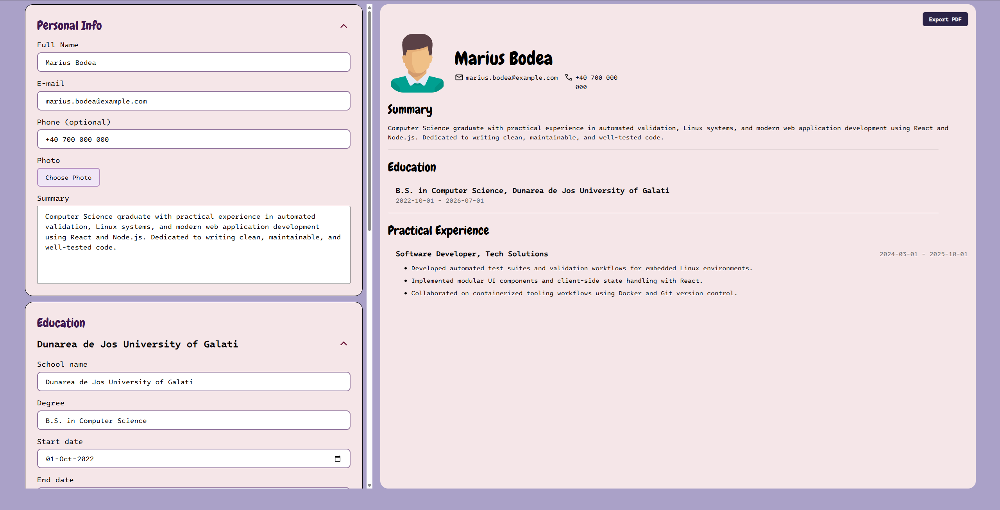

# CV Builder

A lightweight, interactive resume builder and live preview application built with React and Vite. Allows users to fill in details, view real-time document updates, and export a clean PDF.



---

## Tech Stack

* **Frontend:** React 18, JavaScript (ES6+), HTML5
* **Styling:** CSS3, Modular Stylesheets
* **Build Tool:** Vite

---

## Features

* Real-time preview synchronized with form inputs
* Add, edit, and delete multiple education and work entries
* Built-in native PDF export via print styles

---

## Getting Started

1. **Clone the repository:**
   ```bash
   git clone https://github.com/sadwipe/cv-application.git
   cd cv-application
   ```

2. **Install dependencies:**
   ```bash
   npm install
   ```

3. **Run development server:**
   ```bash
   npm run dev
   ```

4. **Build for production:**
   ```bash
   npm run build
   ```
